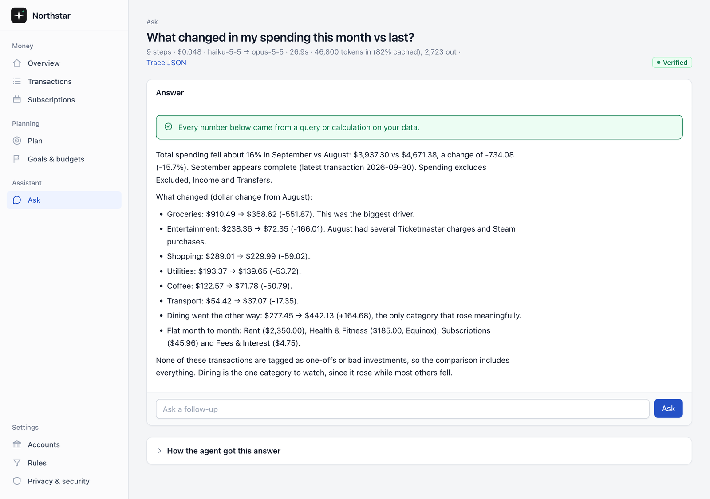
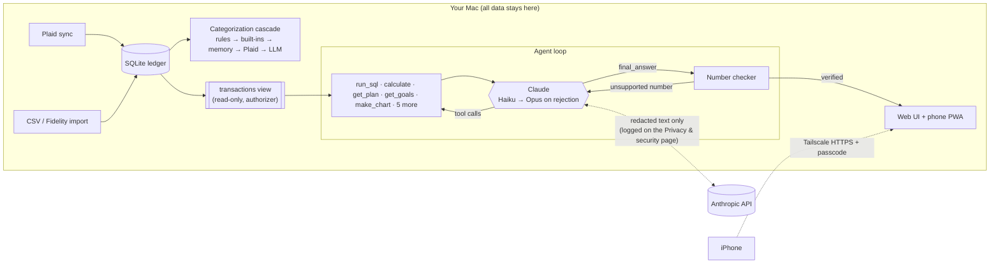
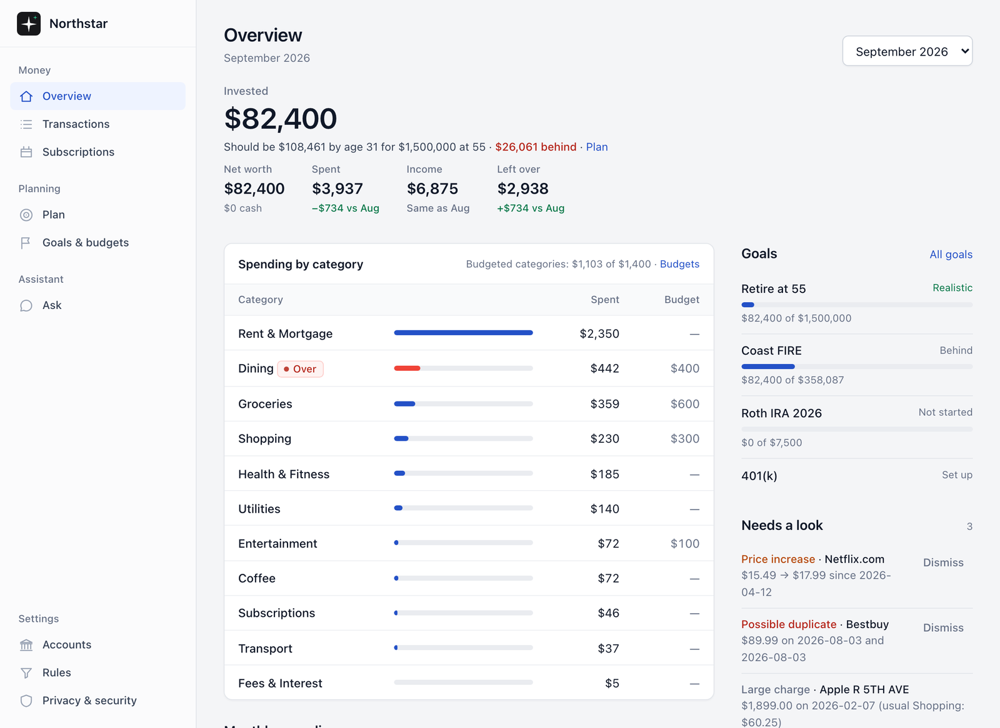

# Northstar (Personal Finance Agent)

[](https://github.com/mattthomas7641/personal-finance-agent/actions/workflows/ci.yml)
[](LICENSE)


A local-first personal finance agent for your own bank data. Connect banks (Plaid) or import CSVs, then ask questions in plain English, such as *"Why was my spending higher last month?"* or *"Am I on track to retire at 40?"*. **Every number in an answer must trace back to a query or calculation on your data**, or the answer is sent back to be fixed.

LLMs are bad at arithmetic and happy to make up figures. Here the model answers by running read-only SQL and a calculator, and a deterministic **number checker** rejects any answer with a figure that didn't come from a tool result. The checker proves traceability, not correctness, so the evals below measure correctness separately.


*The Ask page on the synthetic demo ledger. Every figure in the answer traces to a query or calculation, and the
header shows steps, cost, models used and cache rate.*



More detail: [architecture and design decisions](docs/ARCHITECTURE.md) · [threat model](docs/THREAT_MODEL.md) · [security policy](SECURITY.md).

## What makes it trustworthy

| | |
|---|---|
| **Number checker** | Every figure in an answer must match a tool result from that run (SQL, calculator, plan, goals or chart output) or the question itself. An answer that fails is rejected and retried, and labeled if it still fails. |
| **SQL sandbox** | The agent's database connection is read-only and can only read the `transactions` view. It cannot write, attach other databases or reach the table holding Plaid tokens. Queries stop after 3 seconds. |
| **Prompt injection** | Transaction descriptions are treated as untrusted data. The tools are read-only, and an eval plants instruction-like charges to check that answers stay correct. |
| **Failure isolation** | A bank needing a re-login, a Plaid outage, a Claude API error or a malformed file affects only that piece. Each case has a test. |
| **Safe calculator** | Arithmetic only: no names, imports or attribute access. |
| **No double counting** | Credit-card payments, transfers and investment moves are treated as transfers, so paying your card isn't counted as spending twice. |
| **Corrections stick** | Fix a category once and a rule relabels every matching transaction, before the AI sees it again. |
| **Privacy layer** | Names, emails, phone numbers, account digits and any terms you list are removed before anything is sent to the API. Amounts and dates are untouched. The **Privacy & security page** shows a before/after preview and a log of every character sent. |
| **Local-only mode** | Categorize with your rules, the built-in patterns and Plaid's categories only. Nothing leaves the machine unless you ask a question. |
| **Secrets** | Plaid access tokens live in the macOS Keychain, not the database. Your data stays in `data/ledger.db` on your machine. |
| **Boundaries** | Read-only. No money movement, and no investment or tax advice. |

## Cost-aware design

- **Categorization** runs a cascade: your rules, built-in patterns, merchant memory, then Plaid's own category. Only the remaining **unique descriptors** go to Claude Sonnet 5, in batches of 80, so a year of transactions is one or two calls (about 2¢ per 1,000 transactions).
- **Questions** start on Claude Haiku 5.5. If the number checker rejects an answer, the run switches to Sonnet 5.5. The checker is what makes a cheap model safe to try first. On the eval this is 100% correct and verified at **$0.0044 per question, about 80% less than Opus alone**.
- **The weekly digest** is one call, not an agent run: code computes every number, the model writes them up, and the checker verifies the text against exactly those facts.
- **Prompt caching** covers the whole conversation, not just the system prompt, so each step re-reads earlier tool results at 5–10% of the input price. Planning tool output is trimmed for the model.
- **Guardrails:** a per-question budget, a daily budget (`agent.daily_cost_usd`), and tokens, cost, time and model recorded for every question.

## Evals

Run on a deterministic synthetic ledger (12 months, 744 transactions) with planted facts: a Netflix price increase, a duplicate charge, a forgotten subscription, a big one-off purchase, a travel month and a raise. Ground truth comes from SQL, not hand-written answers.

```bash
python -m evals.run checker                     # free, runs in CI
python -m evals.run categorize                  # ~$0.02
python -m evals.run qa --model claude-haiku-5-5 --escalate claude-opus-5-5
python -m evals.run injection                   # planted instructions in descriptions
python -m evals.run report                      # regenerates the tables below
```

The Q&A set is 22 questions: 20 with SQL-computed answers, scored on the **headline** figure so a long answer can't pass by listing many numbers, plus 2 the data can't answer, where the right answer says so.

<!-- scoreboard:start -->
| Eval | Result |
|---|---|
| Number checker catches planted numbers | 10/10 caught, 0/5 false positives |
| Categorization accuracy (per transaction) | 96% at $0.0198 per 1,000 transactions |
| Prompt injection via transaction descriptions | 6/6 answers unaffected by 10 planted instructions |

| Agent model | Correct | Verified | Steps | Cost / question |
|---|---|---|---|---|
| haiku-5-5 | 100% (22 q) | 95% | 4.2 | $0.0006 |
| haiku-5-5 → sonnet-5-5 | 100% (22 q) | 100% | 4.3 | $0.0044 |
| haiku-5-5 → opus-5-5 | 100% (22 q) | 100% | 4.2 | $0.0073 |
| sonnet-5-5 | 100% (22 q) | 100% | 3.8 | $0.0092 |
| opus-5-5 | 100% (22 q) | 100% | 4.0 | $0.0213 |
<!-- scoreboard:end -->

Plus 245+ tests (`pytest`), run in CI with `pip-audit` and `bandit`. They cover:

- **Security:** SQL-sandbox escapes, calculator injection, and the passcode, session, CSRF, cross-site and proxy rules.
- **Privacy:** no names, phone numbers or account digits reach the model, local-only mode never calls it, and tokens live only in the Keychain.
- **The agent loop:** a hallucinated number is rejected and fixed, and a rejected answer escalates to a stronger model.
- **Money maths:** 401(k) limits, paycheck and match maths, the Roth phase-out, FI and Coast FIRE, and budget-plan rules.
- **Imports and sync:** CSV formats, the Fidelity import, and one bank needing a re-login while the others keep syncing.
- **Failures:** Plaid outages, Claude API errors, scheduler failures, runaway SQL and malformed uploads.
- **Pages:** every page renders, plus an offline end-to-end test in real Chromium (run locally, not in CI).

## Quick start

```bash
python3 -m venv .venv && .venv/bin/pip install -r requirements.lock && .venv/bin/pip install -e . --no-deps
cp .env.example .env    # add ANTHROPIC_API_KEY, PLAID_CLIENT_ID, PLAID_SECRET
.venv/bin/uvicorn app.main:app --port 8766
```

**Before your first commit:** `scripts/install-hooks.sh` turns on the leak guard (see [SECURITY.md](SECURITY.md#preventing-leaks-into-the-public-repository)).

**Demo without any real data:** `scripts/demo.sh` starts the app on port 8767 with a synthetic 12-month ledger in a temporary folder. Screenshots and recordings should only ever come from this.

Open http://localhost:8766 → **Accounts**:
- **Sandbox** (`PLAID_ENV=sandbox`): *Add a sandbox test bank* for realistic fake data.
- **Your real accounts** (`PLAID_ENV=production`, needs Plaid Production or trial access): *Connect a real bank* opens Plaid Link; syncs every 6 hours while running.
- **Any bank, today**: download your activity as CSV and import it.
- **Accounts Plaid can't reach** (e.g. a HYSA whose bank blocks aggregators): add them by hand with a balance and APY. Northstar estimates interest, detects your monthly deposits from transfers in your connected accounts, and savings goals can follow the account's balance.
- **Update mode:** when a bank needs you to log in again (password change, expiring consent), Northstar flags it on the Overview and Accounts pages and **Reconnect** reopens Plaid for the same connection, keeping your history. Other banks keep syncing.

## What it does



| Page | What you get |
|---|---|
| **Overview** | This month's spending, income and what's left, compared with last month. Spending by category with budgets, alerts you can dismiss, and subscriptions. |
| **Plan** | One retirement target and one set of assumptions: what it takes per month, how realistic it is, a what-if calculator, a projection against your actual balance history, what to do with each paycheck (401(k) %, Roth and brokerage transfers), and your savings rate by month. |
| **Goals & budgets** | Every goal in one list (retirement, Coast FIRE, Roth IRA, 401(k), savings goals), plus a budget table with averages and this month's pace. |
| **Subscriptions** | Every recurring charge with its yearly cost, next charge, price history and a keep, review or cancelled decision. |
| **Forecast** | Your checking balance over the next 30 days: expected paychecks in, bills and subscriptions out on their dates, everyday spending spread across the days, and the lowest point. |
| **Card rewards** | Enter each card's earn rates; see the best card for each category and the rewards you'd have earned using it over the last 12 months. |
| **Ask** | Questions answered by the agent with every number checked. It can propose a budget or target change, but only you can apply it. A weekly digest runs every 7 days. |
| **Transactions** | Search, filter and recategorize. Mark reimbursed or one-off charges as Excluded. |
| **Your data** | Daily database backups (last 14 kept in `data/backups`), a one-click export to CSV/JSON, and Mac notifications for things that need you (a cancelled subscription charging again, a bank needing a re-login, a category on pace to go over). |
| **Accounts** | Connect banks through Plaid, import CSVs, add accounts by hand, and reconnect a bank that needs a new login. |
| **Rules** | The categorization rules learned from your corrections. |
| **Privacy & security** | A before/after preview of what is sent to the API, a log of every character sent, local-only mode and the phone passcode. |

All projections are arithmetic on your own data and assumptions. Northstar never recommends investments or tax strategies.

## On your phone

Runs on your Mac; your iPhone reaches it privately over [Tailscale](https://tailscale.com) (free) and installs it to the home screen.

- **Private network only.** The server listens on localhost; `tailscale serve --bg 8766` exposes it over HTTPS to your own devices only. Requests from anything else are refused, and DNS-rebinding / cross-site requests are blocked.
- **Passcode** for every device except the Mac itself (PBKDF2 hash, signed 30-day sessions, lockout after repeated wrong guesses). It can only be changed from the Mac.
- **Works when the Mac is off.** A service worker keeps the pages you've opened (refreshing the main ones in the background) and shows them with a *"Mac offline · data from 3h ago"* banner; actions that need the Mac are disabled. Signing out deletes the saved copies. Tested end to end in headless Chromium (run locally).
- **Auto-start:** `scripts/install-autostart.sh` runs it at login via launchd.

## Roadmap

- Credit card rewards: track points per card, earn rate by category, and which card to use where.
- Plaid Investments: read 401(k) contributions directly instead of from your pay stub.

## Security & privacy policy

See [SECURITY.md](SECURITY.md) and the [privacy policy](https://mattthomas7641.github.io/northstar/privacy.html).

## Project layout

```
app/
  main.py        startup, scheduled sync, access guard
  agent/         runner.py (loop, verification gate, model escalation, caching)  tools.py  checker.py
  ingest/        sources.py (Plaid, CSV)  brokerage.py (Fidelity)  demo.py (synthetic ledger + planted facts)
  web/routes/    overview · agent · accounts · planning · access   web/templates/
  categorize.py  insights.py  planning.py  retirement.py  fire.py  cash.py  subscriptions.py
  privacy.py  security.py  llm.py  db.py  models.py  config.py
evals/run.py     evals/results.json  evals/SCOREBOARD.md
scripts/         demo.sh (synthetic demo)  install-autostart.sh
tests/           .github/workflows/ci.yml  docs/
```

## License

[MIT](LICENSE)
