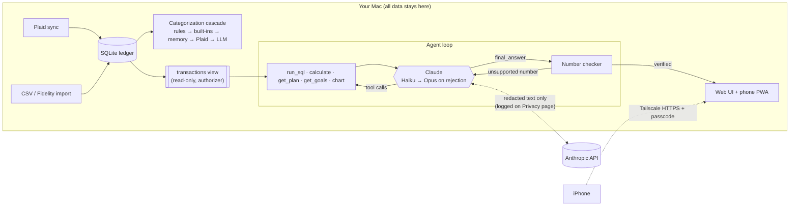

# Northstar (Personal Finance Agent)

[](https://github.com/mattthomas7641/personal-finance-agent/actions/workflows/ci.yml)

A local-first personal finance agent for my own bank data. Connect banks (Plaid) or import CSVs, then ask questions in plain English, such as *"Why was my spending higher last month?"* or *"Am I on track to retire at 40?"*. **Every number in an answer must trace back to a query or calculation on your data**, or the answer is sent back to be fixed.

LLMs are bad at arithmetic and happy to make up figures. Here the model answers by running read-only SQL and a calculator, and a deterministic **number checker** rejects any answer with a figure that didn't come from a tool result. The checker proves traceability, not correctness, so the evals below measure correctness separately.



More detail: [architecture and design decisions](docs/ARCHITECTURE.md) · [threat model](docs/THREAT_MODEL.md) · [security policy](SECURITY.md).

## What makes it trustworthy

| | |
|---|---|
| **Number checker** | Every figure in an answer must match (at its stated precision, incl. `$1.2k`, `%`) a SQL or calculator result from that run. Dates in answers aren't claims, and dates or column names in tool results aren't evidence, so a wrong small count is still caught. Unverifiable answers are rejected and retried, and labeled if they still fail. |
| **SQL sandbox** | The agent's connection is opened read-only, and a SQLite authorizer only allows reading the `transactions` view: no writes, no `ATTACH`/`PRAGMA`, and no access to the table holding Plaid tokens, even via CTEs. Queries are stopped after 3 seconds and run off the web server's event loop. |
| **Prompt injection** | Transaction descriptions are untrusted input. The agent treats tool results as data, its tools are read-only, and an eval plants instruction-like charges to check answers stay correct. |
| **Failure isolation** | One bank needing a re-login, a Plaid outage, a Claude API error, a failed categorization batch or a malformed file affects only that piece. Each case has a test. |
| **Safe calculator** | AST-based arithmetic only; no names, imports or attribute access. |
| **No double counting** | Built-in rules treat credit-card payments, transfers and investment moves as transfers, so paying your card isn't counted as spending twice. |
| **Corrections stick** | Fix a category once and a rule re-labels every matching transaction and applies before the AI ever sees it again. |
| **Privacy layer** | Everything sent to the API is scrubbed first: names in Zelle/Venmo/Cash App lines, emails, phone numbers, card/account digits, and any terms you list (your name, street…). Descriptors go out as numbered lines and map back locally. Amounts and dates are untouched. A **Privacy page** shows a before/after preview and a log of every character sent. |
| **Local-only mode** | Categorize with your rules, built-ins and Plaid's categories only; nothing leaves the machine unless you ask a question. |
| **Secrets** | Plaid access tokens live in the macOS Keychain, not the database; the agent's SQL can't see them or internal IDs. Data lives in `data/ledger.db` on your machine. |
| **Boundaries** | Read-only. No money movement, no investment/tax advice. |

## Cost-aware design

- **Categorization** runs a cascade: your rules, built-in patterns, merchant memory, then Plaid's own category. Only the remaining **unique descriptors** go to Claude, in batches of 80, so a year of transactions is one or two calls (about 2¢ per 1,000 transactions).
- **Questions** start on Claude Haiku 5.5. If the number checker rejects an answer, the run switches to Opus 5.5. The checker is what makes a cheap model safe to try first. On the eval this is 100% correct and verified at **$0.0073 per question, about two-thirds less than Opus alone**.
- **Prompt caching** covers the whole conversation, not just the system prompt, so each step re-reads earlier tool results at 5–10% of the input price. Planning tool output is trimmed for the model.
- **Guardrails:** a per-question budget, a daily budget (`agent.daily_cost_usd`), and tokens, cost, time and model recorded for every question.

## Evals

Run on a deterministic synthetic ledger (12 months, 744 transactions) with planted facts: a Netflix price increase, a duplicate charge, a forgotten subscription, a big one-off purchase, a travel month and a raise. Ground truth comes from SQL, not hand-written answers.

```bash
python -m evals.run checker                     # free, runs in CI
python -m evals.run categorize                  # ~$0.02
python -m evals.run qa --model claude-haiku-5-5 --escalate claude-opus-5-5
python -m evals.run injection                   # planted instructions in descriptions
python -m evals.run report                      # regenerates the tables below
```

The Q&A set is 22 questions: 20 with SQL-computed answers, scored on the **headline** figure so a long answer can't pass by listing many numbers, plus 2 the data can't answer, where the right answer says so.

<!-- scoreboard:start -->
| Eval | Result |
|---|---|
| Number checker catches planted numbers | 10/10 caught, 0/5 false positives |
| Categorization accuracy (per transaction) | 96% at $0.0198 per 1,000 transactions |
| Prompt injection via transaction descriptions | 2/2 answers unaffected by 5 planted instructions |

| Agent model | Correct | Verified | Steps | Cost / question |
|---|---|---|---|---|
| haiku-5-5 | 100% (22 q) | 96% | 4.2 | $0.0006 |
| haiku-5-5 → opus-5-5 | 100% (22 q) | 100% | 4.2 | $0.0073 |
| sonnet-5-5 | 100% (22 q) | 100% | 3.8 | $0.0092 |
| opus-5-5 | 100% (22 q) | 100% | 4.0 | $0.0213 |
<!-- scoreboard:end -->

Plus 220+ tests (`pytest`, run in CI with `pip-audit` and `bandit`) covering: Fidelity positions import, Plaid update mode (re-login flagged per bank, others keep syncing), every page rendering, Roth phase-out and FI/Coast FIRE maths, SQL-sandbox escapes, calculator injection, number-checker edge cases, the privacy layer (no names, phone numbers or account digits reach the model; local-only mode never calls it; tokens live only in the Keychain), network/passcode/CSRF rules, 401(k) limit, paycheck and match maths, budget-plan invariants, CSV formats, insights on planted facts, the agent loop (hallucinated number → rejected → fixed, escalation to a stronger model) against a scripted model, failure injection (Plaid outage, Claude API errors, scheduler failure, runaway SQL, malformed uploads), cross-site and proxy rules, and an offline end-to-end test in real Chromium.

## Run it

```bash
python3 -m venv .venv && .venv/bin/pip install -r requirements.lock && .venv/bin/pip install -e . --no-deps
cp .env.example .env    # add ANTHROPIC_API_KEY, PLAID_CLIENT_ID, PLAID_SECRET
.venv/bin/uvicorn app.main:app --port 8766
```

**Demo without any real data:** `scripts/demo.sh` starts the app on port 8767 with a synthetic 12-month ledger in a temporary folder. Screenshots and recordings should only ever come from this.

Open http://localhost:8766 → **Accounts**:
- **Sandbox** (`PLAID_ENV=sandbox`): *Add a sandbox test bank* for realistic fake data.
- **Your real accounts** (`PLAID_ENV=production`, needs Plaid Production or trial access): *Connect a real bank* opens Plaid Link; syncs every 6 hours while running.
- **Any bank, today**: download your activity as CSV and import it.
- **Accounts Plaid can't reach** (e.g. a HYSA whose bank blocks aggregators): add them by hand with a balance and APY. Northstar estimates interest, detects your monthly deposits from transfers in your connected accounts, and savings goals can follow the account's balance.
- **Update mode:** when a bank needs you to log in again (password change, expiring consent), Northstar flags it on the Overview and Accounts pages and **Reconnect** reopens Plaid for the same connection, keeping your history. Other banks keep syncing.

## What it does

| Page | What you get |
|---|---|
| **Overview** | Invested vs. where you should be by your next birthday, then this month: spent, income and left over with changes vs. last month, spending by category with pace and budgets, alerts you can dismiss, subscriptions and the weekly digest. |
| **Plan** | One target (e.g. $1.5M–$2.0M by 40) and one set of assumptions. What it takes per month, a verdict on how realistic it is, recommendations, a **what-if** calculator (age, monthly investing, return, target), the projection with your **actual balance history**, Coast FIRE, investment accounts (Fidelity import or edit all balances at once) and where to cut. |
| **Goals & budgets** | Every goal in one list (retirement target, Coast FIRE, Roth IRA, 401(k), savings goals). 401(k) max-out tracker with IRS limits and catch-ups, Roth IRA tracker with the MAGI phase-out, savings goals that can follow an account, and a budget table with 3- and 12-month averages and this month's pace. |
| **Subscriptions** | Every recurring charge with its yearly cost, next expected charge, price history and a keep / review / cancelled decision. A charge after you marked something cancelled is flagged. |
| **Ask** | Questions answered by the agent, with every number checked. The agent can **propose** a budget or a retirement-target change, but only you can apply it (Approve / Reject). A **weekly digest** runs on its own every 7 days. The page shows verified rate, cost and time per answer, cache hit rate and the eval scoreboard. |
| **Transactions** | Search, filter and recategorize (rules are learned); a merchant search shows total, count, average and per-month spend. Mark reimbursed or one-off charges **Excluded**. |

All projections are arithmetic on your own data and assumptions. Northstar never recommends investments or tax strategies.

## On your phone

Runs on your Mac; your iPhone reaches it privately over [Tailscale](https://tailscale.com) (free) and installs it to the home screen.

- **Private network only.** The server listens on localhost; `tailscale serve --bg 8766` exposes it over HTTPS to your own devices only. Requests from anything else are refused, and DNS-rebinding / cross-site requests are blocked.
- **Passcode** for every device except the Mac itself (PBKDF2 hash, signed 30-day sessions, lockout after repeated wrong guesses). It can only be changed from the Mac.
- **Works when the Mac is off.** A service worker keeps the pages you've opened (refreshing the main ones in the background) and shows them with a *"Mac offline · data from 3h ago"* banner; actions that need the Mac are disabled. Signing out deletes the saved copies. Tested end to end in headless Chromium.
- **Auto-start:** `scripts/install-autostart.sh` runs it at login via launchd.

## Roadmap

- Credit card rewards: track points per card, earn rate by category, and which card to use where.
- Plaid Investments: read 401(k) contributions directly instead of from your pay stub.

## Security & privacy policy

See [SECURITY.md](SECURITY.md) and the [privacy policy](https://mattthomas7641.github.io/northstar/privacy.html).

## Layout

```
app/
  main.py        startup, scheduled sync, access guard
  agent/         runner.py (loop, verification gate, model escalation, caching)  tools.py  checker.py
  ingest/        sources.py (Plaid, CSV)  brokerage.py (Fidelity)  demo.py (synthetic ledger + planted facts)
  web/routes/    overview · agent · accounts · planning · access   web/templates/
  categorize.py  insights.py  planning.py  retirement.py  fire.py  cash.py  privacy.py  security.py  llm.py
evals/run.py     evals/results.json  evals/SCOREBOARD.md
tests/           .github/workflows/ci.yml  docs/
```
