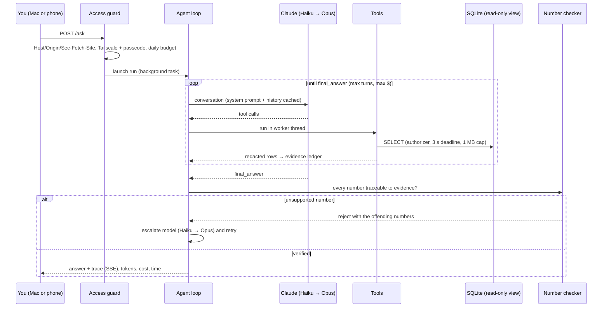

# Architecture and design decisions

Northstar is a **single-process modular monolith**: one FastAPI app, one SQLite file, and a hand-written
tool loop on the Anthropic Messages API, running on one Mac for one person. Everything below follows from
that use case: one user, real bank data, and answers that have to be right.

## Request paths

## Modules

| Module | Responsibility |
|---|---|
| `app/main.py` | Startup, scheduled Plaid sync (survives any failed round), access guard (network allow-list, cross-site checks, passcode sessions, `no-store`) |
| `app/web/routes/` | HTTP routes by area: overview, agent, accounts, planning, access |
| `app/agent/runner.py` | The tool loop: verification gate, rejection loop, model escalation, conversation caching, cost and token accounting |
| `app/agent/tools.py` | Read-only tools: SQL (authorizer + limits), safe AST calculator, insights, goals/plan (trimmed), charts |
| `app/agent/checker.py` | Deterministic number checker: answer claims vs. tool-result evidence |
| `app/categorize.py` | Cost cascade: user rules → whole-word built-ins → merchant memory → Plaid category → batched LLM |
| `app/ingest/` | Plaid `transactions/sync` with per-bank isolation and update mode; CSV and Fidelity parsers; synthetic demo ledger |
| `app/privacy.py` | Redaction before anything leaves the machine, outbound log, Keychain storage |
| `app/planning.py`, `retirement.py`, `fire.py`, `cash.py` | Deterministic finance maths (401(k), Roth, FI/Coast FIRE, retire-by-age plan, cash accounts) |
| `evals/run.py` | Evals on a synthetic ledger with SQL-derived ground truth; per-model scoreboard |

## Failure isolation

| Failure | Behaviour | Test |
|---|---|---|
| One bank needs re-login | Flagged for Reconnect, others keep syncing | `test_update_mode.py` |
| Plaid outage / network error / Keychain error on one bank | Marked "retrying" (or "error"), others keep syncing | `test_hardening.py` |
| Scheduled sync throws | Logged; the loop keeps running | `test_hardening.py` |
| Claude API: bad key, rate limit, outage, no credits | Run fails with a clear message; categorization keeps rule/memory/Plaid results and leaves the rest for later | `test_hardening.py` |
| One categorization batch fails | Other batches' labels are kept | `test_hardening.py` |
| Runaway or malicious SQL | Stopped after 3 s or at 1 MB; returned to the model as an error; the web app stays responsive | `test_hardening.py` |
| A tool raises | Becomes an error result the model can react to | `test_hardening.py` |
| Malformed upload | Error message, nothing half-imported | `test_brokerage_import.py`, `test_hardening.py` |
| Database busy | WAL mode + 10 s busy timeout | — |
| Mac offline | Phone shows its saved copy (≤ 7 days old) with a banner | `test_offline.py` |

## Observability

Every question stores each model step, tool call, tool result and checker verdict, plus tokens (uncached, cached, output), cost, wall time and which model(s) answered. The run page shows them live over SSE, and `/runs/<id>.json` exports the full trace.
